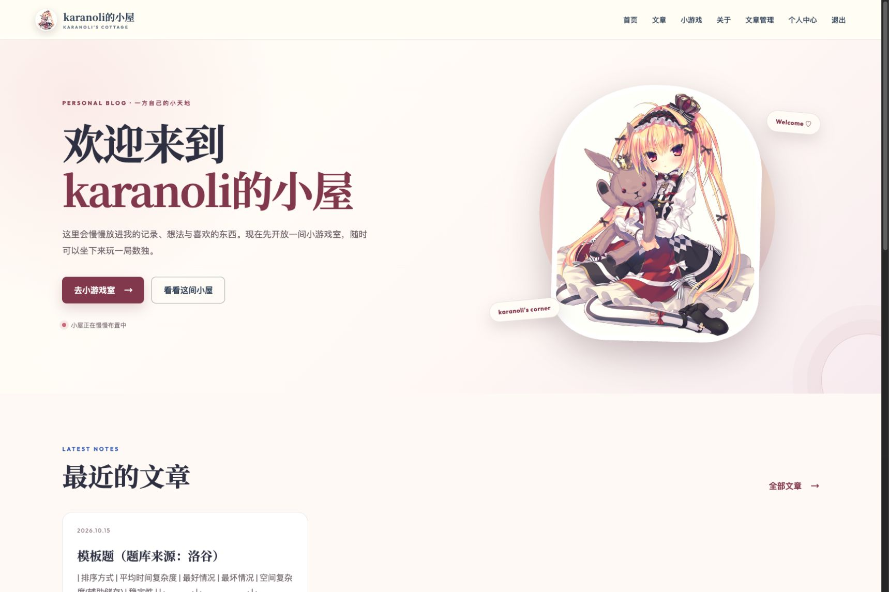
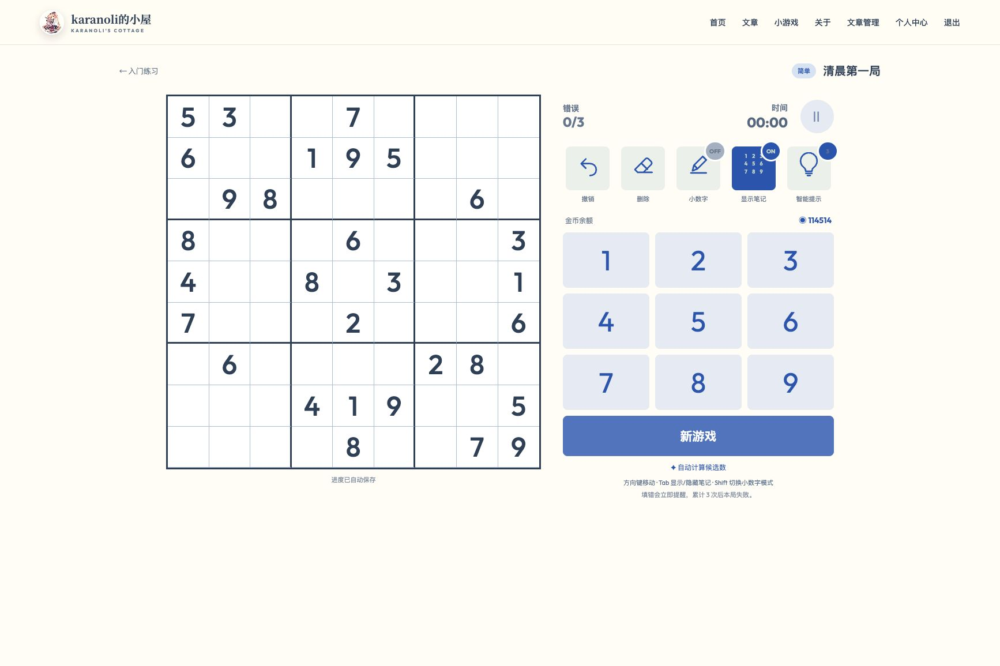

# karanoli的小屋

> 本项目由 **ChatGPT 6.1 sol** 根据需求生成，并在使用过程中通过需求反馈、问题复现与多轮修改逐步完善。

一个使用 Django 构建的个人博客与数独练习网站。管理员上传 Markdown 文件发布文章，读者登录后参与评论，数独作为独立的“小游戏”栏目提供。

数独小游戏包含用户账户、四级题库、持久化棋盘和候选数、教学提示、三次错误失败、金币、每日免费提示、游客模式、图片 OCR/直接输入投稿与后台管理。项目展示与简历描述见 [项目展示与简历说明](项目展示与简历说明.md)，维护入口见 [MAINTENANCE.md](MAINTENANCE.md)。

## 界面预览





## 技术结构

| 层次 | 实现 |
| --- | --- |
| 服务端 | Python、Django、Django ORM、表单与身份认证 |
| 数据存储 | SQLite；迁移文件维护表结构版本 |
| 页面交互 | Django Templates、原生 JavaScript、Fetch、CSS |
| 文章展示 | Markdown、KaTeX、highlight.js |
| 数独算法 | 候选集、最少候选优先回溯、唯一解验证、逻辑提示 |
| 图片识别 | OpenCV 棋盘定位与透视校正、Tesseract OCR、人工复核 |

## 快速启动

环境建议使用 Python 3.12 或更新版本。macOS / Linux：

```bash
python3 -m venv .venv
source .venv/bin/activate
pip install -r requirements.txt
python manage.py migrate
python manage.py seed_sudoku
python manage.py createsuperuser
python manage.py runserver
```

浏览器访问 `http://127.0.0.1:8000/`。

Windows 激活虚拟环境时使用 `.venv\Scripts\activate`。管理员账号由 `createsuperuser` 交互创建；初次运行请自行上传 Markdown 发布文章。

停止服务：在运行服务的终端按 `Ctrl+C`。以后再次启动时，进入项目目录、激活虚拟环境，然后运行 `python manage.py runserver`。更新代码后先执行 `python manage.py migrate`。

图片识别还需要系统安装 Tesseract；macOS 可运行 `brew install tesseract`。未安装时，上传流程仍可进入人工校正页手动录入。

## 演示管理员账号

| 项目 | 内容 |
| --- | --- |
| 用户名 | `karanoli` |
| 密码 | `1145141919810` |
| 管理后台 | `http://127.0.0.1:8000/admin/` |

以上为项目本地演示使用的管理员账号。源码仓库不包含 `db.sqlite3`，因此下载项目后不会自动出现这个账号。首次运行时执行 `python manage.py createsuperuser --username karanoli`，按提示设置上述演示密码或自己的密码，即可使用管理员功能。若采用其他端口，请相应替换后台地址中的 `8000`。

## 已实现功能

- 文章列表、文章详情与首页最新文章；管理员登录后点击导航栏“文章管理”，上传 `.md` 文件即可发布
- 正文支持 Markdown，并通过 KaTeX 渲染 `$...$`、`$$...$$` 等 LaTeX 公式
- 文章底部提供纯文本评论，游客可阅读并看到注册提示；登录后可发布、删除自己的评论
- 评论每页 20 条；后台可搜索、隐藏、恢复或删除评论；注册或登录后可返回原文
- 注册、登录、登出、修改密码与个人统计中心；修改密码后当前设备保持登录
- 登录用户长期保存；游客刷新或离开题目后立即从初始棋盘重新开始
- 四个难度分组，游客仅能进入简单题
- 9×9 棋盘、键盘输入、高亮、计时、暂停、重置、撤销
- 方向键移动选格；Tab 显示/隐藏笔记；Shift 按一下切换小数字模式
- 选择正式数字、点击候选小数字或输入小数字后，全盘同值候选小数字同步高亮
- 已确认的正确数字不会被其他数字直接覆盖，需要先删除才能修改
- 右侧“新游戏”进入同一难度的下一道题并保留当前题进度；结果弹窗的“重新开始”才会清空本题
- 手动候选数总开关与自动候选；正确落子会实时删除同行、同列、同宫中的同值小数字
- 分步教学提示：唯一候选、隐性唯一、裸对/裸三、隐性对/隐性三、指向对/指向三、宫线声明、X-Wing、XY-Wing、剑鱼
- 错误数字会保留并标红；换填仍错继续计错，换填正确后恢复正常颜色，累计三次失败并锁盘
- 每日 3 次免费提示，之后每次默认消耗 100 金币
- 完成奖励：简单 10、中等 20、困难 40、专家 60 金币
- 支持上传题面图片或直接输入 9×9 题面；图片由 OpenCV 定位棋盘、Tesseract 识别数字并支持人工逐格校正
- 题面中的 0 在录入页统一显示为空白，空白提交后仍按 0 处理
- 程序自动求解，检查题面规则与唯一解，生成完整答案并按难度分组入库
- Django Admin 管理用户、题组、题目、记录、投稿与流水
- Admin 可将勾选题目导出为 JSON；运行 `python manage.py import_puzzles 文件.json` 可批量导入

## 发布文章

1. 使用管理员账号登录网站。
2. 点击顶部导航栏的“文章管理”。
3. 点击“增加文章”，只需选择一个 UTF-8 编码的 `.md` 文件并保存。

首次保存时，文章标题默认使用 Markdown 文件名并忽略 `.md` 或 `.markdown` 扩展名；之后可以在文章管理页自由修改标题，系统不会再次覆盖。首段正文会成为摘要，网址标识与发布时间由系统自动生成。文章默认立即发布；之后可改为草稿或调整发布时间。

正文使用标准 Markdown。行内公式写作 `$a^2+b^2=c^2$`，独立公式写作 `$$\\sum_{i=1}^n i$$`。

## 配置

生产环境请设置 `DJANGO_SECRET_KEY`、将 `DJANGO_DEBUG=false`、通过 `DJANGO_ALLOWED_HOSTS` 设置逗号分隔域名，并将数据库改为 PostgreSQL。以下参数可在 `sudoku_site/settings.py` 调整：

- `SUDOKU_HINT_COIN_COST`：一次金币提示的价格（默认 100 金币）
- `SUDOKU_DAILY_FREE_HINTS`：每日免费提示次数
- `SUDOKU_SUBMISSION_REQUIRES_REVIEW`：投稿是否需要管理员审核

## 数据与公开范围

本仓库只包含源代码、数据库迁移、示例题生成命令、说明文档和公开界面截图。实际数据库 `db.sqlite3`、上传目录 `media/`、虚拟环境和 `.env` 文件均通过 `.gitignore` 排除；用户、密码哈希、邮箱、游戏进度和私人文章不会随源代码上传。下载者通过迁移与 `seed_sudoku` 创建自己的演示数据。

密码由 Django 的密码哈希系统保存；评论作为纯文本显示，并经过服务端校验和模板转义。评论作者由登录会话确定，删除时重新检查归属，写请求由 CSRF 中间件保护。

当前为可本地运行的作品，尚未声明公网部署或高并发性能。SQLite 下 `select_for_update()` 不提供行级锁，不能据此宣称已经验证高并发下的金币一致性；正式部署前需要迁移到 PostgreSQL 并补充并发验证。文章渲染依赖外部 CDN，OCR 效果取决于图片质量。

## 后续维护

项目根目录的 `MAINTENANCE.md` 逐项说明了每个源文件的用途、核心数据流、常见扩展位置和上线前检查清单。增加文章功能、小游戏规则或账户能力前，建议先查阅该文件。
